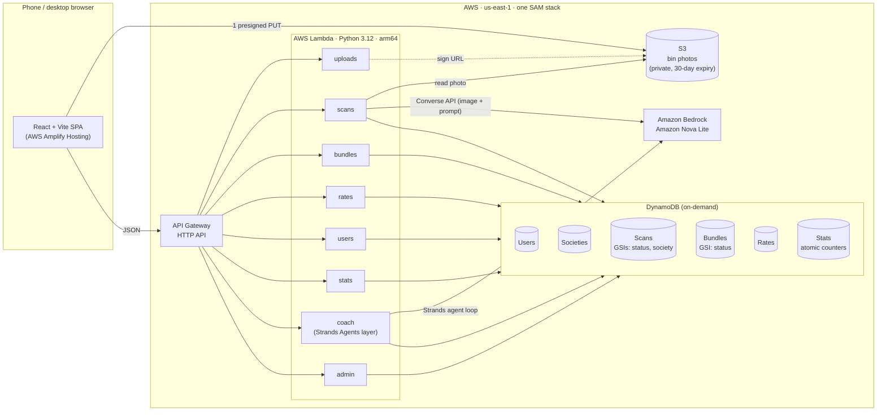

# Architecture

## Request flows

**Scan (household).** The browser compresses the photo (max 1280 px, JPEG 0.8), asks `POST /uploads` for a 5-minute presigned PUT URL, and uploads straight to S3. `POST /scans` reads the photo (max 5 MB) and calls Bedrock Converse with Amazon Nova Lite and a fixed prompt. It parses the JSON reply (retrying once if it's invalid), clamps weights, maps unknown materials to landfill, **prices the recyclables in code** from the Rates table, saves the scan, and adds to the city, society and user counters.

**Bundle → pickup (picker).** `POST /bundles/build` groups `pending` scans by society. A group becomes a bundle when it holds at least 1.5 kg of recyclables or any scan in it is older than 12 h. Each bundle is written in one DynamoDB transaction, together with its scan updates. `GET /bundles` orders open bundles by nearest neighbour (haversine distance) from the picker's base. Accepting a bundle is a conditional write, so two pickers can't take the same one. Collecting it recomputes the value at current rates, splits it 60% to households (pro rata by kg) and 40% to the picker, with the rounding remainder going to the picker. It also credits simulated EPR rewards and updates every counter.

**City view.** `GET /stats/city` returns the counters and the mountain height factor, `max(0.5, 1 − divertedKg / TARGET_KG)`. The page polls every 5 s and animates the 3D mound towards the new height.

**Coach.** `POST /coach` runs a Strands Agents `Agent` with a `BedrockModel` and four tools: material totals, scan history, rates and society rank. Each tool is a closure bound to the requesting user, so the model can only read that household's data. The response includes the list of tools actually called, and the UI shows it as "Checked: …".

## Design decisions

- **The LLM never computes money.** Vision output is treated as untrusted data. It is validated with pydantic, clamped, and only then priced by `lib/pricing.py`, which is fully unit-tested.
- **One function per resource, least-privilege policies.** For example, the stats function has read-only access to two tables.
- **Strands ships as a Lambda layer** (about 61 MB unzipped for arm64), so the other functions stay small.
- **Atomic counters** (`UpdateItem ADD`) keep the dashboards consistent without scanning tables.
- **Stretch goals not built yet:** Step Functions pipeline (S1), Cognito (S2), Polly (S3), Amazon Location Service (S4), EventBridge/SNS (S5), Hindi UI (S6).
